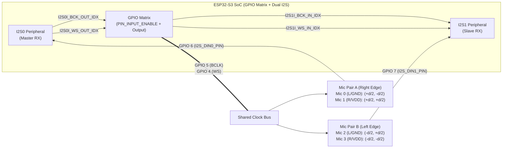

# 4-Microphone Square Array Upgrade Plan (Dual-Band GCC-PHAT & 6-Pair WLS Fusion)

## Goal Description

Upgrade the `acoustic-doa-esp32` firmware on branch `feature/quad-mic-square-fusion` from a 2-microphone 1D linear array ($\theta \in [-90^\circ, +90^\circ]$, subject to front/back ambiguity and elevation cone-of-confusion) to a **4-microphone 2D planar square array** ($d = 82\text{ mm}$) resolving full $360^\circ$ azimuth ($\phi \in [-180^\circ, +180^\circ]$).

Key capabilities introduced by this upgrade:
1. **Phase-Locked 4-Channel Audio Capture**: Dual ESP32-S3 I2S controllers (`I2S0` Master RX + `I2S1` Slave RX) synchronized via the ESP32-S3 GPIO Matrix with deterministic Slave-before-Master startup ordering.
2. **Full 6-Pair Dual-Band GCC-PHAT Pipeline**: 4 forward FFTs, precomputed dual-band raised-cosine spectral weights ($300\text{--}2200\text{ Hz}$ for the 4 edge pairs; $300\text{--}1450\text{ Hz}$ for the 2 diagonal pairs to prevent spatial aliasing), and 6 inverse FFTs within a $\le 12\text{ ms}$ Core 1 execution budget.
3. **Multipath Loop-Closure Validation & 2D WLS Solver**: Closed-triangle zero-sum delay consistency checking ($\tau_{ij} + \tau_{jk} + \tau_{ki} \approx 0$) combined with a closed-form $2\times 2$ Weighted Least-Squares (WLS) solver over all $\binom{4}{2} = 6$ baselines.
4. **Circular UI & Diagnostics**: $S^1$ circular wrap-around EMA smoothing across the $\pm 180^\circ$ boundary, a $360^\circ$ polar radar UI on the $128\times 160$ ST7735 TFT, and 4-channel Power-On Self-Test (POST) diagnostics.

---

## User Review Required

> [!IMPORTANT]
> **Pin Assignment for Second Stereo I2S Data Line (`I2S_DIN1_PIN`):**
> - `I2S0` (Mic Pair A: Mic 0 Right-Back & Mic 1 Right-Front) uses `GPIO 5` (`BCLK`), `GPIO 4` (`WS`), and `GPIO 6` (`I2S_DIN0_PIN`).
> - `I2S1` (Mic Pair B: Mic 2 Left-Front & Mic 3 Left-Back) shares `BCLK` (`GPIO 5`) and `WS` (`GPIO 4`) internally via the ESP32-S3 GPIO Matrix (`GPIO_MODE_INPUT_OUTPUT` + `esp_rom_gpio_connect_in_signal`) and uses **`GPIO 7` (`I2S_DIN1_PIN`)** for its stereo SD data line.
> - Confirm whether `GPIO 7` is convenient on your breadboard/PCB layout, or if you prefer a different free GPIO (e.g., `GPIO 15` or `GPIO 16`).

> [!NOTE]
> **Binary REST Telemetry Backwards Compatibility (`POST /api/v1/meritve`):**
> - The 20-byte binary record layout (`offset_ms`, `angle_deg`, `delay_us`, `calibrated_db`, `confidence`) is preserved without breaking the wire format.
> - `angle_deg` expands from $[-90^\circ, +90^\circ]$ to $[-180^\circ, +180^\circ]$ ($0^\circ = \text{Front/North}$, $+90^\circ = \text{Right/East}$, $\pm 180^\circ = \text{Back/South}$, $-90^\circ = \text{Left/West}$).
> - `delay_us` reports the equivalent projected broadside delay along the primary X-axis baseline ($\tau_{\text{equiv}} = \frac{d}{c}\sin\phi \cdot 10^6\text{ }\mu\text{s}$), preserving physical continuity with the 2-mic schema.

---

## 1. File-by-File Impact Matrix

| File | Action | Detailed Modifications |
|---|---|---|
| [`src/app_config.h`](../src/app_config.h) | **MODIFY** | - Add `AUDIO_NUM_CHANNELS = 4` and `AUDIO_NUM_PAIRS = 6`. - Add `I2S_SLAVE_PORT_NUM = 1` and `I2S_DIN1_PIN = 7` (keeping `I2S_DIN_PIN = 6` aliased to `I2S_DIN0_PIN`). - Add dual-band cutoff constants: `GCC_PHAT_MIN_HZ = 300.0f`, `GCC_PHAT_EDGE_MAX_HZ = 2200.0f`, `GCC_PHAT_DIAG_MAX_HZ = 1450.0f`, `GCC_PHAT_RAMP_HZ = 100.0f`. - Add loop-closure threshold `DOA_LOOP_CLOSURE_TOLERANCE_SAMPLES = 1.5f`. - Expand `ANGLE_OFFSET_MIN_DEG = -180.0f` and `ANGLE_OFFSET_MAX_DEG = 180.0f`. - Update radar center geometry constants for $360^\circ$ circular layout (`RADAR_CENTER_X = 64`, `RADAR_CENTER_Y = 44`, `RADAR_RADIUS = 34`). |
| [`src/i2s_sampler.h`](../src/i2s_sampler.h) | **NEW** | - Declare `init_i2s_microphones(uint32_t sample_rate)`, `deinit_i2s_microphones()`, `read_i2s_quad(int32_t* ch0, int32_t* ch1, int32_t* ch2, int32_t* ch3, size_t count)`, and legacy wrapper `read_i2s_stereo(int32_t* left, int32_t* right, size_t count)`. |
| [`src/i2s_sampler.cpp`](../src/i2s_sampler.cpp) | **MODIFY** | - Configure `I2S0` as Master RX (`I2S_MODE_MASTER \| I2S_MODE_RX`) and `I2S1` as Slave RX (`I2S_MODE_SLAVE \| I2S_MODE_RX`). - Route `GPIO 5` (`BCLK`) and `GPIO 4` (`WS`) to both `I2S0` output and `I2S1` input (`I2S1I_BCK_IN_IDX`, `I2S1I_WS_IN_IDX`) via `GPIO_MODE_INPUT_OUTPUT` and `esp_rom_gpio_connect_in_signal()`. - Enforce deterministic Slave-first startup (`i2s_start(I2S_NUM_1)` then `i2s_start(I2S_NUM_0)`) and synchronous 6-block warmup discard. - Implement `read_i2s_quad()` demuxing `I2S0` stereo DMA into `(ch0, ch1)` and `I2S1` stereo DMA into `(ch2, ch3)`. |
| [`src/post_checker.h`](../src/post_checker.h) | **MODIFY** | - Expand `MicrophoneHealthResult` (or add `QuadMicrophoneHealthResult` while keeping 2-mic fields/overload for compatibility) with per-channel health `ch_ok[4]`, `ch_rms_db[4]`, `ch_min[4]`, `ch_max[4]`, `bus0_distinct` (Mic 0 vs Mic 1), `bus1_distinct` (Mic 2 vs Mic 3), and `cross_bus_distinct` (Bus 0 vs Bus 1). |
| [`src/post_checker.cpp`](../src/post_checker.cpp) | **MODIFY** | - Implement `evaluate_quad_microphone_health(const int32_t* const channels[4], size_t count)` validating variance, flatline (`<= -95 dBFS`), rail short (`>= -3 dBFS`), and pairwise collision (`< 85%` identical samples) across all 4 channels. |
| [`src/gcc_phat.h`](../src/gcc_phat.h) | **MODIFY** | - Add 4-channel `DoaResult process(const int32_t* ch0, const int32_t* ch1, const int32_t* ch2, const int32_t* ch3)` alongside legacy 2-channel `process(left, right)`. - Extend `DoaResult` with optional diagnostic telemetry (`float pair_confidence_mean`, `float loop_residual_us`, `uint8_t active_pairs`). - Replace `fft_x1`, `fft_x2` pointers with `float* fft_ch[AUDIO_NUM_CHANNELS]`, plus precomputed weight buffers `float* band_weight_edge` and `float* band_weight_diag`. |
| [`src/gcc_phat.cpp`](../src/gcc_phat.cpp) | **MODIFY** | - Precompute `band_weight_edge` ($300\text{--}2200\text{ Hz}$) and `band_weight_diag` ($300\text{--}1450\text{ Hz}$) during `configure()`. - Compute 4-channel unwindowed RMS (`0.25f * sum(raw_s[k]^2)`) for omnidirectional energy detection. - Execute 4 forward FFTs (`dsps_fft2r_fc32` + `dsps_bit_rev_fc32`). - Loop over all 6 pairs: compute PHAT cross-spectrum with edge/diagonal band weights in shared `ccorr` buffer, run IFFT, and extract sub-sample delay $\tau_p$ and peak $\text{confidence}_p$ via 3-point parabolic interpolation. - Evaluate 4 closed-triangle loop residuals ($\tau_{ij} + \tau_{jk} + \tau_{ki}$), down-weight inconsistent pairs, and solve the $2\times 2$ WLS normal equations for $\hat{\mathbf{u}} = [\hat{u}_x, \hat{u}_y]^T$ and $\phi = \text{atan2f}(\hat{u}_x, \hat{u}_y) \cdot \frac{180^\circ}{\pi} \in [-180^\circ, +180^\circ]$. |
| [`src/display_filter.h`](../src/display_filter.h) [`src/display_filter.cpp`](../src/display_filter.cpp) | **MODIFY** | - Add `static float wrapAngle180(float angle_deg)` and `static float shortestAngularDiff(float target_deg, float current_deg)` mapping differences into $[-180^\circ, +180^\circ]$. - Replace linear subtraction `raw_angle - smoothed_angle_deg` and $[-90^\circ, +90^\circ]$ clamping with circular modular arithmetic so transitions across $\pm 180^\circ$ (e.g., $+178^\circ \to -178^\circ$, $\Delta = +4^\circ$) smooth continuously without triggering false outliers or wrapping through $0^\circ$. |
| [`src/main.cpp`](../src/main.cpp) | **MODIFY** | - Allocate 4 static channel buffers (`ch0_buf`..`ch3_buf`) in `dsp_task` and call `read_i2s_quad()` + 4-channel `doa.process()`. - Update `show_boot_prompt()` and `run_boot_self_test()` to display compact 4-mic POST status (`M0..M3` and `SYNC`). - Upgrade `draw_radar_ui()` to render a full $360^\circ$ circular radar (`cx = 64, cy = 44, r = 34`) with concentric rings, crosshair axes, cardinal labels (`0`, `+90`, `180`, `-90`), and full-circle polar needle. - Update captive portal & remote calibration validator to accept `angle_offset_deg` in $[-180^\circ, +180^\circ]$. |
| [`test/test_adaptive_and_smoothing.cpp`](../test/test_adaptive_and_smoothing.cpp) | **MODIFY** | - Add unit tests for: (1) 4-channel POST health & collision heuristics, (2) circular EMA wrap-around across $\pm 180^\circ$, (3) 6-pair WLS synthetic wavefront solver across all 4 quadrants ($0^\circ, +90^\circ, \pm 180^\circ, -90^\circ, \pm 45^\circ, \pm 135^\circ$), and (4) loop-closure outlier rejection under simulated multipath. |
| [`doc/hardware.md`](hardware.md) [`doc/firmware.md`](firmware.md) [`doc/rest-api.md`](rest-api.md) | **MODIFY** | - Document 4-mic square geometry, `GPIO 7` (`I2S_DIN1_PIN`) wiring, GPIO Matrix clock sharing, 6-pair dual-band WLS pipeline, and $[-180^\circ, +180^\circ]$ telemetry range. |

---

## 2. Hardware Synchronization & Memory Layout Strategy

### 2.1 Dual-I2S GPIO Matrix Clock Sharing & Startup Sequence

1. **Internal GPIO Matrix Clock Loopback (Zero External Jumper Wires Required)**:
   - On ESP32-S3, `I2S0` in Master RX mode outputs bit clock (`I2S0I_BCK_OUT_IDX`) and word select (`I2S0I_WS_OUT_IDX`).
   - If `i2s_set_pin(I2S_NUM_1, ...)` is called naively with `bck_io_num = 4` and `ws_io_num = 5`, the ESP-IDF driver calls `gpio_set_direction(pin, GPIO_MODE_INPUT)`, which disables `I2S0`'s output driver on those pads.
   - **Solution**:
     1. Call `i2s_set_pin(I2S_NUM_0, ...)` with `bck_io_num = 4`, `ws_io_num = 5`, `data_in_num = 6`.
     2. Call `i2s_set_pin(I2S_NUM_1, ...)` with `bck_io_num = I2S_PIN_NO_CHANGE`, `ws_io_num = I2S_PIN_NO_CHANGE`, `data_in_num = 7`.
     3. Re-enable bidirectional pad mode on `GPIO 5` and `GPIO 4` (`gpio_set_direction(pin, GPIO_MODE_INPUT_OUTPUT)`) and bind `I2S0`'s output signals and `I2S1`'s slave input signals (`I2S1I_BCK_IN_IDX`, `I2S1I_WS_IN_IDX`) to `GPIO 5` and `GPIO 4` via `esp_rom_gpio_connect_in_signal()` and `esp_rom_gpio_connect_out_signal()`.
2. **Deterministic Slave-Before-Master Startup Sequence**:
   - After installing both drivers, explicitly pause both controllers (`i2s_stop(I2S_NUM_0)`, `i2s_stop(I2S_NUM_1)`).
   - Clear DMA descriptor rings on both (`i2s_zero_dma_buffer(I2S_NUM_1)`, `i2s_zero_dma_buffer(I2S_NUM_0)`).
   - Call `i2s_start(I2S_NUM_1)` (**Slave RX first**) so its shift register is armed before the first clock edge.
   - Call `i2s_start(I2S_NUM_0)` (**Master RX second**) so `I2S0` and `I2S1` begin capturing on the exact same `WS` frame edge.
   - Discard `POST_WARMUP_BLOCKS` (6 blocks $\approx 140\text{ ms}$) from both controllers in lockstep to flush the INMP441 startup transient.

---

### 2.2 Memory & Buffer Layout Strategy (Internal SRAM vs. PSRAM)

To avoid Octal PSRAM cache misses during tight radix-2 butterfly loops on Core 1, all hot DSP working buffers are allocated in **Internal SRAM** (`MALLOC_CAP_INTERNAL | MALLOC_CAP_8BIT`), with per-buffer fallback to `MALLOC_CAP_SPIRAM | MALLOC_CAP_8BIT` only if internal heap is fragmented.

| Buffer | Type & Dimensions | Size @ $N = 1024$ | Size @ $N = 2048$ | Placement & Rationale |
|---|---|---:|---:|---|
| `interleaved_buf` (`i2s_sampler.cpp`) | `int32_t[2048 * 2]` | 16 KB | 16 KB | Static `.bss` (Internal SRAM) — reused sequentially for `I2S0` and `I2S1` DMA reads. |
| `ch0_buf` .. `ch3_buf` (`dsp_task`) | `4 × int32_t[2048]` | 32 KB | 32 KB | Static `.bss` (Internal SRAM) — holds demuxed 32-bit PCM for the 4 channels. |
| `GccPhat::window` | `float[N]` | 4 KB | 8 KB | `MALLOC_CAP_INTERNAL` — Hann window coefficients. |
| `GccPhat::band_weight_edge` | `float[N]` | 4 KB | 8 KB | `MALLOC_CAP_INTERNAL` — Precomputed $300\text{--}2200\text{ Hz}$ raised-cosine weights (eliminates $4N$ `cosf()` calls/frame). |
| `GccPhat::band_weight_diag` | `float[N]` | 4 KB | 8 KB | `MALLOC_CAP_INTERNAL` — Precomputed $300\text{--}1450\text{ Hz}$ raised-cosine weights (eliminates $2N$ `cosf()` calls/frame). |
| `GccPhat::fft_ch[4]` | `4 × float[2 * N]` | 32 KB | 64 KB | `MALLOC_CAP_INTERNAL` — Complex forward spectra $X_0(f) \dots X_3(f)$ kept resident across all 6 pair combinations. |
| `GccPhat::ccorr` | `1 × float[2 * N]` | 8 KB | 16 KB | `MALLOC_CAP_INTERNAL` — **Reused sequentially** across each of the 6 pairs for cross-spectrum + in-place IFFT + peak search, saving 40 KB (@ 1024) / 80 KB (@ 2048) of SRAM and staying hot in L1 data cache. |
| **Total `GccPhat` Heap** | — | **52 KB** | **104 KB** | Fits comfortably inside ESP32-S3's ~260 KB free internal SRAM. |

### 2.3 Core 1 Execution Timing Budget ($N = 1024$ @ $44.1\text{ kHz}$, Budget $= 23.22\text{ ms}$)

| Pipeline Stage | Operations ($N = 1024$) | Estimated Time (ESP32-S3 @ 240 MHz) |
|---|---|---:|
| 1. DC Removal, 4-Ch RMS & Hann Windowing | 4 channels $\times 1024$ MACs | $0.25\text{ ms}$ |
| 2. 4 Forward Radix-2 FFTs + Bit Reversal | $4 \times$ (`dsps_fft2r_fc32` + `dsps_bit_rev_fc32`) | $1.80\text{ ms}$ |
| 3. 6-Pair Dual-Band Cross-Spectrum + Magnitude Norm | $6 \times 45\text{ active bins}$ (`sqrtf` + table lookup, zero `cosf()`) | $0.45\text{ ms}$ |
| 4. 6 Inverse Radix-2 FFTs + Bit Reversal | $6 \times$ (`dsps_fft2r_fc32` + `dsps_bit_rev_fc32`) | $2.70\text{ ms}$ |
| 5. Parabolic Peak Search, Loop Closure & $2\times 2$ WLS | $6 \times 33\text{ lags}$ + 4 triangle checks + $2\times 2$ solve | $0.05\text{ ms}$ |
| **Total Core 1 Execution Time** | **10 FFTs + Lightweight WLS** | **$\approx 5.25\text{ ms}$ ($\le 12.0\text{ ms}$ limit, $22.6\%$ CPU)** |

---

## 3. Mathematical Formulation for the 2D Angle Solver

### 3.1 Coordinate System & 6-Pair Baseline Geometry

Let the square array of side length $d = 0.082\text{ m}$ lie in the horizontal $(X, Y)$ plane with center at $(0, 0)$:
- **Azimuth Convention**: $\phi \in [-180^\circ, +180^\circ]$ measured clockwise from **North / Front ($+Y = 0^\circ$)**, so $+X = +90^\circ$ (Right/East), $-X = -90^\circ$ (Left/West), and $-Y = \pm 180^\circ$ (Back/South). This preserves exact sign and zero-direction compatibility with the existing 1D $[-90^\circ, +90^\circ]$ front hemisphere.
- **Unit Propagation Vector Pointing Toward Source**:
  $$\mathbf{u}(\phi, \theta_{\text{el}}) = \cos(\theta_{\text{el}}) \begin{bmatrix} \sin\phi \\ \cos\phi \end{bmatrix} = \begin{bmatrix} u_x \\ u_y \end{bmatrix}, \quad \|\mathbf{u}\| = \cos(\theta_{\text{el}}) \le 1$$
- **Microphone Corner Coordinates**:
  $$\mathbf{r}_0 = \begin{bmatrix} +d/2 \\ -d/2 \end{bmatrix}\text{ (RB)}, \quad \mathbf{r}_1 = \begin{bmatrix} +d/2 \\ +d/2 \end{bmatrix}\text{ (RF)}, \quad \mathbf{r}_2 = \begin{bmatrix} -d/2 \\ +d/2 \end{bmatrix}\text{ (LF)}, \quad \mathbf{r}_3 = \begin{bmatrix} -d/2 \\ -d/2 \end{bmatrix}\text{ (LB)}$$

For each ordered pair $p = (i, j)$, the cross-spectrum is $G_{ij}(f) = X_i(f) X_j^*(f)$. A positive correlation peak lag $\tau_p > 0$ means the wavefront reaches microphone $j$ before microphone $i$ ($t_i - t_j = \tau_p > 0$). Defining the directed baseline vector $\mathbf{b}_p = \mathbf{r}_j - \mathbf{r}_i$:
$$\mathbf{b}_p \cdot \mathbf{u} = c \cdot \tau_p$$

| Pair Index $p$ | Ordered Mics $(i, j)$ | Type | Baseline Vector $\mathbf{b}_p = \mathbf{r}_j - \mathbf{r}_i$ | Length $\|\mathbf{b}_p\|$ | $f_{\text{alias}} = \frac{c}{2\|\mathbf{b}_p\|}$ | Bandpass Cutoff |
|---:|:---:|:---:|:---:|:---:|:---:|:---:|
| **0** | $(0, 1)$ | Right Edge ($+Y$) | $(0, +d)$ | $82.0\text{ mm}$ | $2097\text{ Hz}$ | $300\text{--}2200\text{ Hz}$ |
| **1** | $(1, 2)$ | Front Edge ($-X$) | $(-d, 0)$ | $82.0\text{ mm}$ | $2097\text{ Hz}$ | $300\text{--}2200\text{ Hz}$ |
| **2** | $(3, 2)$ | Left Edge ($+Y$) | $(0, +d)$ | $82.0\text{ mm}$ | $2097\text{ Hz}$ | $300\text{--}2200\text{ Hz}$ |
| **3** | $(0, 3)$ | Back Edge ($-X$) | $(-d, 0)$ | $82.0\text{ mm}$ | $2097\text{ Hz}$ | $300\text{--}2200\text{ Hz}$ |
| **4** | $(3, 1)$ | Diag LB $\to$ RF | $(+d, +d)$ | $115.97\text{ mm}$ | $1483\text{ Hz}$ | $300\text{--}1450\text{ Hz}$ |
| **5** | $(0, 2)$ | Diag RB $\to$ LF | $(-d, +d)$ | $115.97\text{ mm}$ | $1483\text{ Hz}$ | $300\text{--}1450\text{ Hz}$ |

---

### 3.2 Dual-Band Raised-Cosine Spectral Weighting

For frequency bin $k$ with frequency $f_k = \text{min}(k, N - k)\frac{f_s}{N}$, the bandpass weight $W(f_k; f_{\min}, f_{\max}, f_{\text{ramp}})$ with $f_{\min} = 300\text{ Hz}$ and $f_{\text{ramp}} = 100\text{ Hz}$ is:

$$W(f; f_{\min}, f_{\max}, f_{\text{ramp}}) = \begin{cases} 
0, & f \le f_{\min} - f_{\text{ramp}} \text{ or } f \ge f_{\max} + f_{\text{ramp}} \\
\frac{1}{2}\left[1 - \cos\left(\pi \frac{f - (f_{\min} - f_{\text{ramp}})}{f_{\text{ramp}}}\right)\right], & f_{\min} - f_{\text{ramp}} < f < f_{\min} \\
1, & f_{\min} \le f \le f_{\max} \\
\frac{1}{2}\left[1 - \cos\left(\pi \frac{(f_{\max} + f_{\text{ramp}}) - f}{f_{\text{ramp}}}\right)\right], & f_{\max} < f < f_{\max} + f_{\text{ramp}}
\end{cases}$$

- **Edge Pairs ($p \in \{0, 1, 2, 3\}$)**: $W_{\text{edge}}(f_k) = W(f_k; 300\text{ Hz}, 2200\text{ Hz}, 100\text{ Hz})$.
- **Diagonal Pairs ($p \in \{4, 5\}$)**: $W_{\text{diag}}(f_k) = W(f_k; 300\text{ Hz}, 1450\text{ Hz}, 100\text{ Hz})$, rolling off cleanly before the diagonal spatial aliasing frequency $f_{\text{alias}} = \frac{c}{2 d\sqrt{2}} \approx 1483\text{ Hz}$.

Each pair's normalized cross-correlation after IFFT is divided by $\sum_{k=0}^{N-1} W_p(f_k)$ so that peak $\text{confidence}_p \in [0, 1]$ is scale-invariant across both bands.

---

### 3.3 Closed-Triangle Loop Closure Consistency (Reverberation & Outlier Rejection)

Any three microphones $(i, j, k)$ form a closed spatial triangle whose true time-of-arrival differences must sum to zero:
$$\tau_{ij} + \tau_{jk} + \tau_{ki} = (t_i - t_j) + (t_j - t_k) + (t_k - t_i) = 0$$

Using our 6 defined pair directions $\tau_0 \dots \tau_5$, the 4 closed-triangle residuals (in samples, $\Delta n_p = \tau_p \cdot f_s$) are:
1. **Triangle $(0, 1, 2)$ [Pairs 0, 1, 5]**:
   $$e_0 = |\Delta n_0 + \Delta n_1 - \Delta n_5|$$
2. **Triangle $(0, 3, 2)$ [Pairs 3, 2, 5]**:
   $$e_1 = |\Delta n_3 + \Delta n_2 - \Delta n_5|$$
3. **Triangle $(0, 1, 3)$ [Pairs 0, 3, 4]**:
   $$e_2 = |\Delta n_0 - \Delta n_3 - \Delta n_4|$$
4. **Triangle $(3, 1, 2)$ [Pairs 4, 1, 2]**:
   $$e_3 = |\Delta n_4 + \Delta n_1 - \Delta n_2|$$

Each pair $p$ participates in exactly 2 triangles $(t_{p,1}, t_{p,2})$. Define pair consistency penalty $\psi_p$ with tolerance $\sigma_{\text{loop}} = 1.5\text{ samples}$:
$$e_{\text{pair}, p} = \min(e_{t_{p,1}}, e_{t_{p,2}}), \quad \psi_p = \exp\left(-\frac{e_{\text{pair}, p}^2}{2 \sigma_{\text{loop}}^2}\right)$$
- If a single pair suffers a multipath reflection spike, the other 3 mics form a consistent triangle ($e_{t} \approx 0$), preserving the clean pairs ($\psi_{\text{clean}} \approx 1$) while heavily down-weighting the corrupted pair ($\psi_{\text{bad}} \ll 1$).
- If **zero** triangles satisfy $e_t \le 2.5\text{ samples}$ AND fewer than 2 orthogonal edge pairs exceed `correlation_threshold`, the frame is rejected as incoherent reverberation/noise (`result.valid = false`).

---

### 3.4 2D Weighted Least-Squares (WLS) Azimuth Estimator

Each pair $p \in \{0 \dots 5\}$ receives composite weight:
$$w_p = \begin{cases} \text{confidence}_p^2 \cdot \psi_p, & \text{if } \text{confidence}_p \ge 0.75 \cdot \text{correlation\_threshold} \\ 0, & \text{otherwise} \end{cases}$$

We minimize the weighted squared residual over $\mathbf{u} = [u_x, u_y]^T$:
$$J(\mathbf{u}) = \sum_{p=0}^{5} w_p \left(\mathbf{b}_p^T \mathbf{u} - c \tau_p\right)^2$$

Setting $\nabla_{\mathbf{u}} J(\mathbf{u}) = \mathbf{0}$ yields the $2\times 2$ normal equations $\mathbf{A} \hat{\mathbf{u}} = \mathbf{g}$:
$$\mathbf{A} = \begin{bmatrix} S_{xx} & S_{xy} \\ S_{xy} & S_{yy} \end{bmatrix} = \sum_{p=0}^{5} w_p \begin{bmatrix} b_{px}^2 & b_{px} b_{py} \\ b_{px} b_{py} & b_{py}^2 \end{bmatrix}, \quad \mathbf{g} = \begin{bmatrix} g_x \\ g_y \end{bmatrix} = c \sum_{p=0}^{5} w_p \tau_p \begin{bmatrix} b_{px} \\ b_{py} \end{bmatrix}$$

With small diagonal regularization $\lambda = 10^{-6} d^2$ to guarantee invertibility even if only collinear pairs fire:
$$D = (S_{xx} + \lambda)(S_{yy} + \lambda) - S_{xy}^2$$
$$\hat{u}_x = \frac{(S_{yy} + \lambda) g_x - S_{xy} g_y}{D}, \quad \hat{u}_y = \frac{(S_{xx} + \lambda) g_y - S_{xy} g_x}{D}$$

1. **Physical Plausibility & Confidence Gate**:
   - Compute weighted mean confidence $\overline{C} = \frac{\sum_{p=0}^5 w_p \text{confidence}_p}{\sum_{p=0}^5 w_p}$ (or mean of top-4 pairs). Require $\overline{C} \ge \text{correlation\_threshold}$ and $\|\hat{\mathbf{u}}\| = \sqrt{\hat{u}_x^2 + \hat{u}_y^2} \in (0.05, 1.35]$.
2. **Full $360^\circ$ Azimuth & Rotational Offset Compensation**:
   $$\phi_{\text{raw}} = \text{atan2f}(\hat{u}_x, \hat{u}_y) \cdot \frac{180^\circ}{\pi} \in [-180^\circ, +180^\circ]$$
   $$\phi_{\text{cal}} = \text{wrap}_{180}(\phi_{\text{raw}} - \text{angle\_offset\_deg})$$
   where $\text{wrap}_{180}(\alpha) = \text{fmodf}(\alpha + 540^\circ, 360^\circ) - 180^\circ$.
3. **Equivalent Delay Telemetry**:
   $$\text{delay\_us} = \left(\frac{d \cdot \sin(\phi_{\text{cal}} \cdot \pi / 180^\circ)}{c}\right) \times 10^6$$

---

## 4. Phased Implementation Roadmap

Every task, sub-step, and verification gate is structured as an actionable `- [ ]` checkbox. Execution **must pause** at each phase's Stop Gate for verification before advancing to the next phase.

### Phase 1: Dual I2S Hardware Capture & 4-Mic POST
- [x] **Step 1.1 — Update Hardware & Audio Constants in [`src/app_config.h`](../src/app_config.h)**:
  - [x] Add `AUDIO_NUM_CHANNELS = 4`, `AUDIO_NUM_PAIRS = 6`, `I2S_MASTER_PORT_NUM = 0`, `I2S_SLAVE_PORT_NUM = 1`, `I2S_DIN0_PIN = 6`, and `I2S_DIN1_PIN = 7`.
- [x] **Step 1.2 — Create [`src/i2s_sampler.h`](../src/i2s_sampler.h) & Upgrade [`src/i2s_sampler.cpp`](../src/i2s_sampler.cpp)**:
  - [x] Configure `I2S_NUM_0` as Master RX (`GPIO 5` BCLK, `GPIO 4` WS, `GPIO 6` DIN0) and `I2S_NUM_1` as Slave RX (`GPIO 7` DIN1).
  - [x] Bind `GPIO 5` and `GPIO 4` in `GPIO_MODE_INPUT_OUTPUT` through the ESP32-S3 GPIO Matrix (`esp_rom_gpio_connect_in_signal` to `I2S1I_BCK_IN_IDX` and `I2S1I_WS_IN_IDX`) so `I2S1` locks onto `I2S0`'s clock without extra external jumpers.
  - [x] Implement deterministic startup: `i2s_stop` both $\to$ `i2s_zero_dma_buffer` both $\to$ `i2s_start(I2S_NUM_1)` (Slave first) $\to$ `i2s_start(I2S_NUM_0)` (Master second) $\to$ discard `POST_WARMUP_BLOCKS` (6 blocks) from both ports.
  - [x] Implement `read_i2s_quad(int32_t* ch0, int32_t* ch1, int32_t* ch2, int32_t* ch3, size_t count)` and keep `read_i2s_stereo()` as a 2-channel wrapper.
- [x] **Step 1.3 — Upgrade 4-Mic Health Heuristics in [`src/post_checker.h`](../src/post_checker.h) & [`src/post_checker.cpp`](../src/post_checker.cpp)**:
  - [x] Extend `MicrophoneHealthResult` with 4-channel fields (`ch_ok[4]`, `ch_rms_db[4]`, `ch_min[4]`, `ch_max[4]`, `bus0_distinct`, `bus1_distinct`, `cross_bus_distinct`, `all_ok`) while preserving existing `left_ok`/`right_ok` fields for compatibility.
  - [x] Implement `evaluate_quad_microphone_health()` checking flatline, rail-short, intra-bus L/R collision, and cross-bus data-line shorting across all 4 channels.
- [x] **Step 1.4 — Phase 1 Verification & Stop Gate**:
  - [x] Add 4-mic POST unit tests in `test/test_adaptive_and_smoothing.cpp` (all 4 nominal, single-channel flatline, single-channel rail short, Bus 1 L/R collision, Bus 0/1 cross-collision).
  - [x] Run host unit tests with ASAN/UBSAN (`g++ -std=gnu++11 -O2 -Wall -Wextra -Werror -fsanitize=address,undefined -I test/mock_esp -I src`) and verify 100% pass before proceeding to Phase 2.

---

### Phase 2: 4-Channel FFT Pipeline & Dual-Band Weighting
- [x] **Step 2.1 — Upgrade `GccPhat` Buffers & Configuration in [`src/gcc_phat.h`](../src/gcc_phat.h) & [`src/gcc_phat.cpp`](../src/gcc_phat.cpp)**:
  - [x] Replace `fft_x1`, `fft_x2` with `float* fft_ch[4]`, plus `float* band_weight_edge` and `float* band_weight_diag`.
  - [x] Allocate all buffers in `GccPhat::configure()` using `MALLOC_CAP_INTERNAL | MALLOC_CAP_8BIT` with `MALLOC_CAP_SPIRAM | MALLOC_CAP_8BIT` fallback and clean rollback on failure.
  - [x] Precompute `band_weight_edge` ($300\text{--}2200\text{ Hz}$, $100\text{ Hz}$ ramps) and `band_weight_diag` ($300\text{--}1450\text{ Hz}$, $100\text{ Hz}$ ramps) and their normalization sums `weight_sum_edge` and `weight_sum_diag` inside `configure()`.
- [x] **Step 2.2 — Implement 4-Channel Forward Stage & 6-Pair IFFT Stage**:
  - [x] Compute 4-channel DC removal, unwindowed omnidirectional stereo/quad RMS (`0.25f * sum(raw_s[k]^2)`), adaptive noise floor gating, and Hann windowing.
  - [x] Run 4 forward complex FFTs (`dsps_fft2r_fc32` + `dsps_bit_rev_fc32`) on `fft_ch[0..3]`.
  - [x] For each of the 6 pairs, compute the PHAT-normalized, dual-band-weighted cross-spectrum in `ccorr` and execute the in-place IFFT.
- [x] **Step 2.3 — Phase 2 Verification & Stop Gate**:
  - [x] Add unit tests verifying 4-channel omnidirectional RMS symmetry across all 4 inputs (`ch0`..`ch3`) and dual-band weight table generation ($2200\text{ Hz}$ vs. $1450\text{ Hz}$ cutoffs).
  - [x] Run host unit tests with ASAN/UBSAN and confirm zero memory leaks or out-of-bounds accesses before proceeding to Phase 3.

---

### Phase 3: 6-Pair Delay Refinement, Loop Validation & 2D WLS Solver
- [x] **Step 3.1 — Implement Sub-Sample Parabolic Peak Refinement for All 6 Pairs**:
  - [x] Search each pair $p \in \{0 \dots 5\}$ within its physical lag bound $\text{max\_lag}_p = \lceil \frac{\|\mathbf{b}_p\|}{c} f_s \rceil + 1$ ($12$ samples for edges, $16$ samples for diagonals).
  - [x] Refine peak index with 3-point parabolic interpolation to obtain $(\tau_p, \text{confidence}_p)$.
- [x] **Step 3.2 — Implement Triangle Loop-Closure Multipath Filter & $2\times 2$ WLS Azimuth Solver**:
  - [x] Compute the 4 closed-triangle loop closure residuals $e_0 \dots e_3$ and apply Gaussian consistency weights $\psi_p = \exp(-e_{\text{pair},p}^2 / (2 \sigma_{\text{loop}}^2))$.
  - [x] Assemble and solve the $2\times 2$ WLS normal equations $\mathbf{A}\hat{\mathbf{u}} = \mathbf{g}$ for $[\hat{u}_x, \hat{u}_y]^T$.
  - [x] Compute $\phi_{\text{raw}} = \text{atan2f}(\hat{u}_x, \hat{u}_y) \cdot \frac{180^\circ}{\pi}$, apply `angle_offset_deg` with $[-180^\circ, +180^\circ]$ wrap-around, and populate `DoaResult`.
- [x] **Step 3.3 — Phase 3 Verification & Stop Gate**:
  - [x] Implement a full-pipeline synthetic FFT/IFFT test in `test/test_adaptive_and_smoothing.cpp` injecting delayed broadband signals across all 4 quadrants ($0^\circ, +45^\circ, +90^\circ, +135^\circ, \pm 180^\circ, -135^\circ, -90^\circ, -45^\circ$) and verifying $< 1.5^\circ$ azimuth accuracy.
  - [x] Add a synthetic multipath test corrupting one pair's lag by $+8$ samples and verifying that loop-closure weighting suppresses the corrupted pair and recovers the true angle.
  - [x] Run host unit tests with ASAN/UBSAN and verify 100% pass before proceeding to Phase 4.

---

### Phase 4: Circular Display Smoothing, 360° Radar UI & Telemetry
- [x] **Step 4.1 — Upgrade [`src/display_filter.h`](../src/display_filter.h) & [`src/display_filter.cpp`](../src/display_filter.cpp) for Circular $S^1$ Smoothing**:
  - [x] Implement `wrapAngle180()` and `shortestAngularDiff()` so angular differences, outlier comparisons, and EMA updates operate on the unit circle $[-180^\circ, +180^\circ]$ without discontinuity at $\pm 180^\circ$.
- [x] **Step 4.2 — Upgrade [`src/main.cpp`](../src/main.cpp) for Quad-Mic DSP, 360° TFT Radar UI & Telemetry**:
  - [x] Update `dsp_task` to read 4 channels via `read_i2s_quad()` and invoke 4-channel `doa.process(ch0, ch1, ch2, ch3)`.
  - [x] Update `run_boot_self_test()` and `show_boot_prompt()` to report all 4 microphones (`M0..M3`) and stereo bus independence.
  - [x] Redesign `draw_radar_ui()` to draw a full $360^\circ$ circular radar (`cx = 64, cy = 44, r = 34`) with outer/inner range rings, N/E/S/W crosshair lines, cardinal degree markers (`0`, `+90`, `180`, `-90`), and a $360^\circ$ polar needle while keeping the bottom telemetry dashboard (`y = 84..159`).
  - [x] Update angle offset validation bounds in NVS/Portal/API to $[-180^\circ, +180^\circ]$.
- [x] **Step 4.3 — Update Documentation ([`doc/hardware.md`](hardware.md), [`doc/firmware.md`](firmware.md), [`doc/rest-api.md`](rest-api.md))**:
  - [x] Document the 4-mic square wiring (`GPIO 6` + `GPIO 7`), 6-pair dual-band WLS architecture, and $360^\circ$ telemetry conventions.
- [x] **Step 4.4 — Phase 4 Final Verification Gate**:
  - [x] Add unit tests in `test/test_adaptive_and_smoothing.cpp` for circular EMA boundary crossing ($+175^\circ \leftrightarrow -175^\circ$) and outlier rejection across $\pm 180^\circ$.
  - [x] Execute full unit test suite with ASAN/UBSAN and verify clean firmware build.